# 🎬 CinePath — Cinema Booking Web Platform

> A modern cinema web application for browsing movies, checking showtimes, selecting seats in real time, and booking tickets online.
> **Version 1 scope: Web only.** Mobile (Play Store) is planned for a later phase.

> ℹ️ *"CinePath" is a working title. Replace it with your own brand name and avoid using trademarked names (e.g. Pathé) in public branding.*

---

## 📑 Table of Contents

1. [Project Overview](#1-project-overview)
2. [Goals & Scope](#2-goals--scope)
3. [Stakeholders & Personas](#3-stakeholders--personas)
4. [Requirements](#4-requirements)
5. [Tech Stack](#5-tech-stack)
6. [System Architecture](#6-system-architecture)
7. [UML Diagrams](#7-uml-diagrams)
8. [Database Design](#8-database-design)
9. [REST API Design](#9-rest-api-design)
10. [Security Plan](#10-security-plan)
11. [UI/UX Design](#11-uiux-design)
12. [Project Structure](#12-project-structure)
13. [Development Phases (Roadmap)](#13-development-phases-roadmap)
14. [Testing Strategy](#14-testing-strategy)
15. [DevOps & Deployment](#15-devops--deployment)
16. [Risks & Mitigation](#16-risks--mitigation)
17. [Future Work](#17-future-work)
18. [Contributing & License](#18-contributing--license)

---

## 1. Project Overview

**CinePath** lets moviegoers discover films, choose a cinema, pick a showtime, select seats on an interactive seat map, pay online, and receive a QR-code e-ticket. Cinema staff and administrators manage movies, halls, schedules, pricing, and sales through a dedicated admin dashboard.

### Core value
| For customers | For cinema operators |
|---|---|
| Fast booking, no queues | Centralized schedule & pricing control |
| Real-time seat availability | Sales and occupancy analytics |
| Digital tickets (QR) | Fewer manual operations, fewer errors |

---

## 2. Goals & Scope

### 2.1 Goals
- Deliver a reliable, fast, secure online ticket-booking experience.
- Prevent double-booking of seats (strong consistency via atomic Redis locks + PostgreSQL partial unique indexes).
- Provide a clean admin back-office with visual seat-grid configuration.
- Build an architecture that can later power a mobile app (API-first).

### 2.2 In Scope (Version 1 — Web)
- Public catalog: movies, cinemas, showtimes (with audio/subtitle language & projection format)
- Authentication & user profiles
- Interactive seat selection (supporting aisles, VIP tiers, wheelchair spaces) with atomic temporary seat locking
- Online payment (Stripe test mode first) with late-webhook race condition protection
- E-ticket with HMAC-signed QR code + email confirmation
- Booking history & cancellation (allowing cancelled seats to be re-sold)
- Admin dashboard (CRUD + reports)
- Ticket validation by staff (QR scan)
- **UX-first booking flow:** guest checkout, best-seat suggestion, ticket type per seat, visible hold timer (see §11)

### 2.3 Out of Scope (for now)
- Native mobile apps (Play Store / App Store)
- Food & beverage ordering
- Loyalty program & gift cards
- Multi-language CMS (basic i18n may be added later)

---

## 3. Stakeholders & Personas

| Actor | Description | Main goals |
|---|---|---|
| **Guest** | Unregistered visitor | Browse movies and showtimes |
| **Customer** | Registered user | Book/cancel tickets, view history |
| **Cashier / Staff** | Cinema employee | Validate tickets, sell at counter |
| **Admin** | Manager | Manage catalog, halls, prices, users, reports |
| **Payment Provider** | External system (Stripe) | Process payments & refunds |
| **Email Service** | External system | Send confirmations & refund notices |

---

## 4. Requirements

### 4.1 Functional Requirements

| ID | Requirement | Priority |
|---|---|---|
| FR-01 | Users can register, log in, log out, reset password | High |
| FR-02 | Users can browse and search movies (title, genre, language) | High |
| FR-03 | Users can view movie details (synopsis, trailer, cast, rating) | High |
| FR-04 | Users can view showtimes by cinema, date, format (2D/3D/IMAX), and language (VF/VOSTFR) | High |
| FR-05 | Users can select seats on an interactive grid map (showing aisles, VIP, and broken seats) | High |
| FR-06 | Selected seats are atomically locked for 10 minutes (with a 12-minute backend grace TTL) | High |
| FR-07 | Users can pay online and receive a confirmation (or auto-refund if lock expired) | High |
| FR-08 | System generates an HMAC-signed QR-code e-ticket (PDF / page) | High |
| FR-09 | Users can view and cancel bookings (releasing seats for re-purchase) | Medium |
| FR-10 | Users can leave ratings/reviews after attending | Low |
| FR-11 | Admin can manage movies, cinemas, halls (grid layout), showtimes, prices | High |
| FR-12 | Admin can view sales and occupancy reports | Medium |
| FR-13 | Staff can validate tickets by scanning QR codes | Medium |
| FR-14 | Promo codes / discounts with usage limits | Low |
| FR-15 | Guest checkout (email only, no account required) | High |
| FR-16 | "Best available seats" suggestion for N seats | Medium |
| FR-17 | Visible 10-minute hold countdown with warnings and recovery on expiry | High |
| FR-18 | Ticket type (Normal / Student / Senior) selectable per seat on the seat screen | High |

### 4.2 Non-Functional Requirements

| Category | Requirement |
|---|---|
| **Performance** | Pages load < 2.5 s (LCP); API p95 < 300 ms |
| **Scalability** | Stateless backend, horizontally scalable |
| **Availability** | 99.5%+ uptime target |
| **Consistency** | No active seat can be sold twice for the same showtime |
| **Security** | OWASP Top 10 compliance, HTTPS only, signed QR payloads |
| **Accessibility** | WCAG 2.1 AA |
| **SEO** | Server-side rendering for public pages |
| **Responsive** | Mobile-first UI |
| **Maintainability** | TypeScript, linting, tests, CI/CD |
| **Privacy** | GDPR-friendly: data export & deletion |

---

## 5. Tech Stack

> ✅ **Next.js + Node.js + PostgreSQL is an excellent choice** for this project: great SEO (SSR), one language (TypeScript) end-to-end, and PostgreSQL's transactions/partial unique indexes combined with Redis Lua scripts are ideal for seat booking.

| Layer | Technology | Why |
|---|---|---|
| Frontend | **Next.js (App Router) + TypeScript** | SSR/SEO, routing, performance |
| Styling | Tailwind CSS + shadcn/ui | Fast, consistent UI |
| State/Data | TanStack Query, React Hook Form, Zod | Caching & validation |
| Backend | **Node.js + NestJS (or Express) + TypeScript** | Structured, scalable API |
| ORM | **Prisma** (or Drizzle) | Type-safe DB access, migrations |
| Database | **PostgreSQL** | ACID, relational integrity, partial indexes |
| Cache / Locks | **Redis** | Atomic Lua seat locks (TTL), rate limiting, sessions |
| Auth | JWT (access + refresh) / NextAuth + OAuth (Google) | Secure authentication |
| Payments | **Stripe** (test mode) | Reliable, webhook & refund support |
| Email | Resend / SendGrid / Nodemailer | Confirmations & alerts |
| File storage | Cloudinary / S3 | Posters & media |
| Real-time | WebSocket (Socket.IO) | Live seat updates |
| Testing | Jest, Supertest, Playwright | Unit, API, E2E |
| DevOps | Docker, GitHub Actions | CI/CD |
| Hosting | Vercel (web) + Railway/Render/VPS (API, DB, Redis) | Easy start |
| Monitoring | Sentry, Grafana/Prometheus (optional) | Observability |

---

## 6. System Architecture

### 6.1 High-Level Architecture

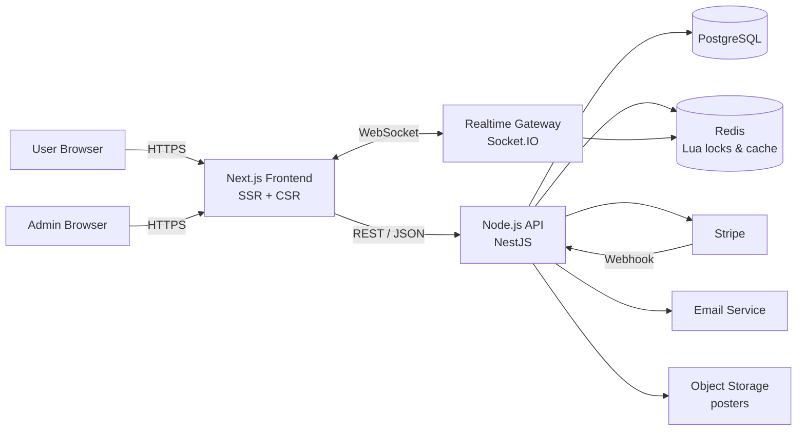

### 6.2 Layered Backend Design

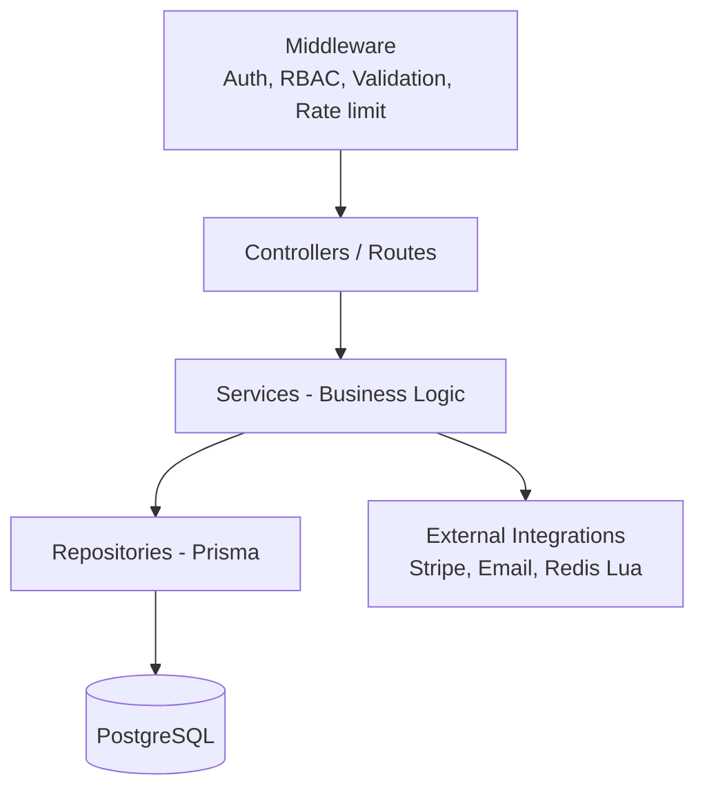

---

## 7. UML Diagrams

### 7.1 Use Case Diagram

> Mermaid has no native use-case notation, so it is represented using a flowchart (actors → use cases).

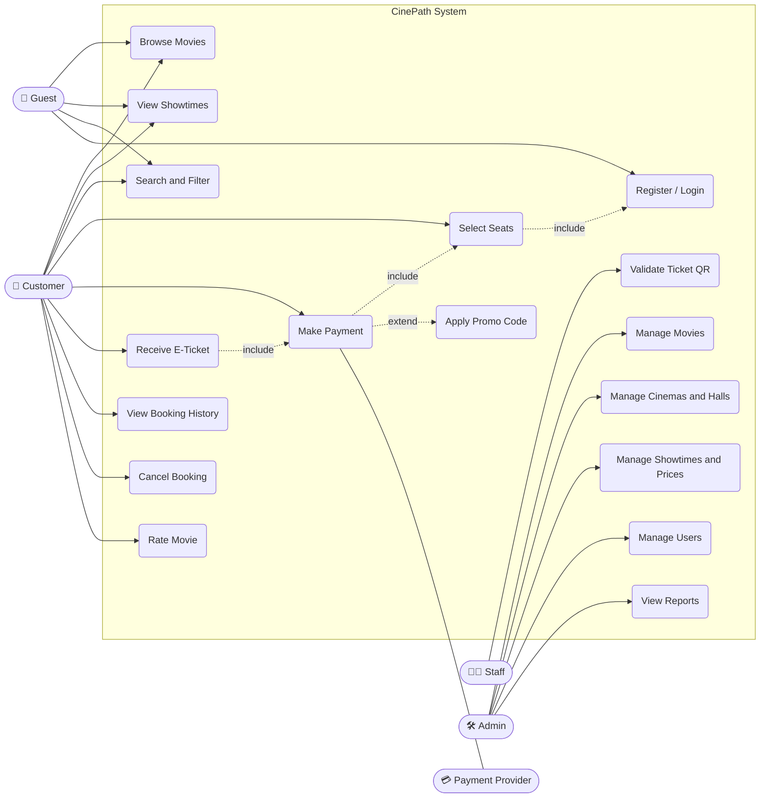

### 7.2 Class Diagram

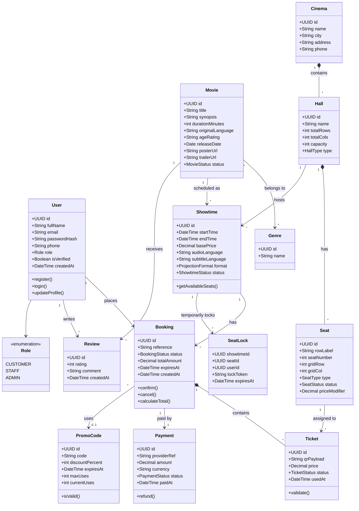

### 7.3 Sequence Diagram — Booking Flow (With Atomic Locks & Late-Webhook Auto-Refund)

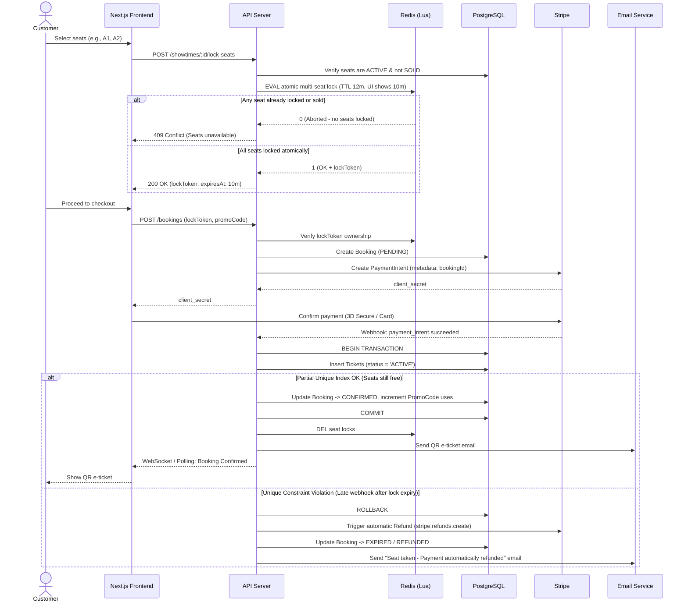

### 7.4 State Diagram — Booking Lifecycle

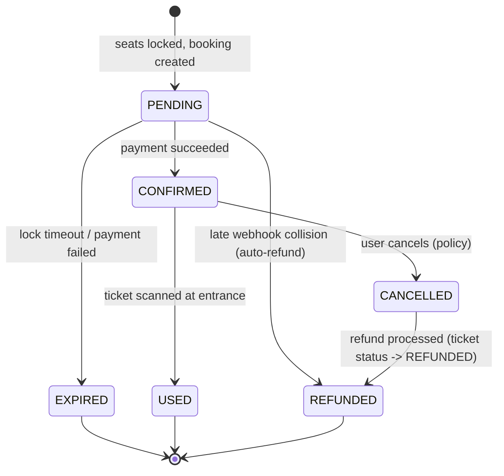

### 7.5 Activity Diagram — Ticket Validation (Staff)

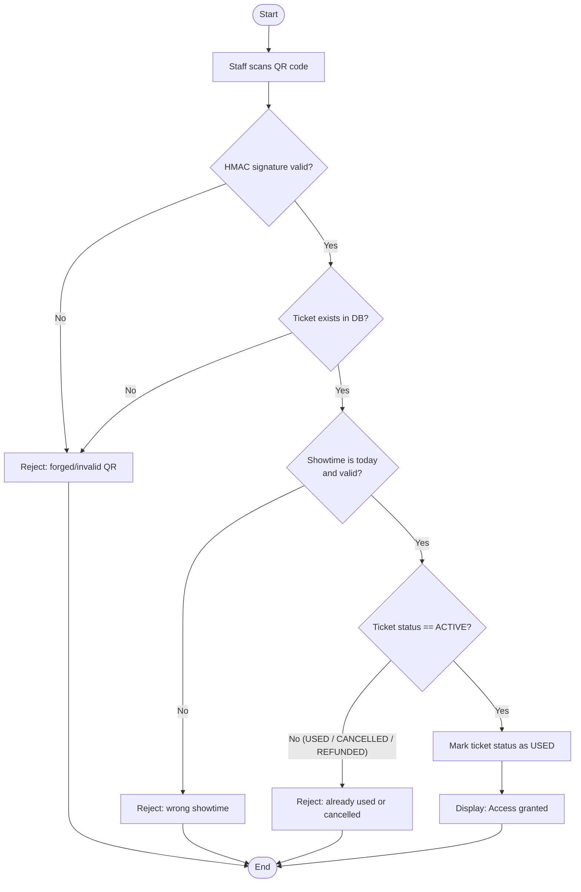

---

## 8. Database Design

### 8.1 Entity-Relationship Diagram

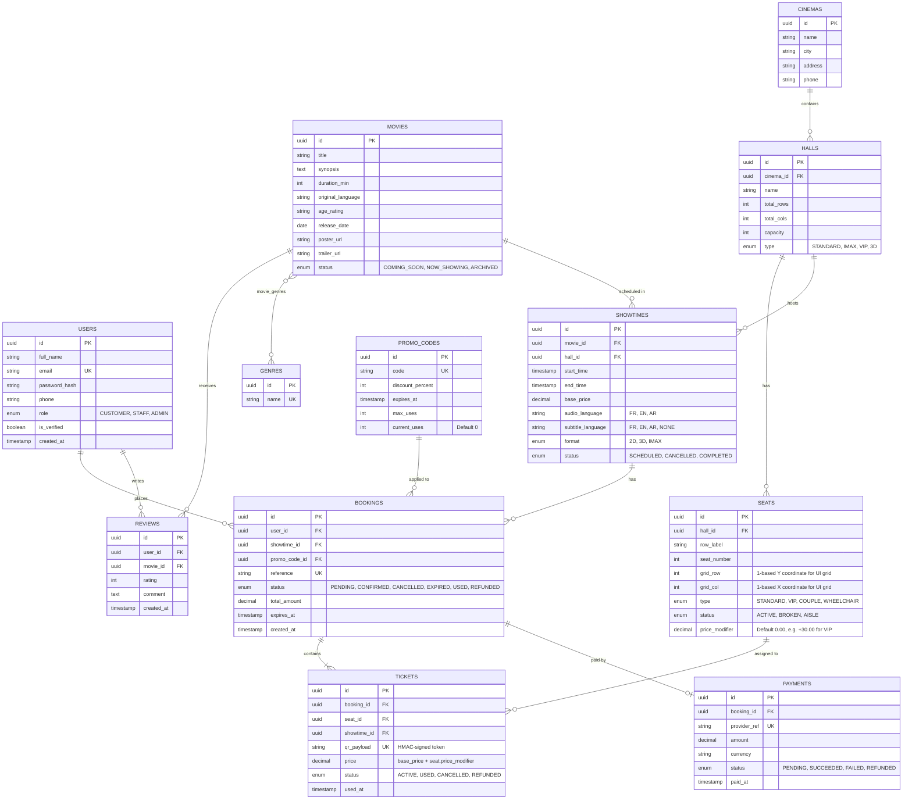

### 8.2 Critical Constraints & Indexes

```sql
-- 1. Prevent double-booking while allowing re-booking of CANCELLED/REFUNDED seats
CREATE UNIQUE INDEX uq_active_ticket_seat_showtime
  ON tickets (showtime_id, seat_id)
  WHERE status IN ('ACTIVE', 'USED');

-- 2. Prevent duplicate seat coordinates inside the same cinema hall
ALTER TABLE seats
  ADD CONSTRAINT uq_hall_grid_position UNIQUE (hall_id, grid_row, grid_col),
  ADD CONSTRAINT uq_hall_seat_label UNIQUE (hall_id, row_label, seat_number);

-- 3. Prevent promo code over-redemption at the database level
ALTER TABLE promo_codes
  ADD CONSTRAINT chk_promo_uses CHECK (current_uses <= max_uses);

-- 4. Performance indexes for high-traffic queries
CREATE INDEX idx_showtimes_movie_start ON showtimes (movie_id, start_time);
CREATE INDEX idx_showtimes_hall_start ON showtimes (hall_id, start_time);
CREATE INDEX idx_bookings_user ON bookings (user_id, created_at DESC);
CREATE INDEX idx_bookings_expired_cleanup ON bookings (status, expires_at) WHERE status = 'PENDING';
CREATE INDEX idx_movies_status ON movies (status);
```

### 8.3 Seat Locking & Concurrency Strategy

1. **Atomic Multi-Seat Lock (Redis Lua):** When a user selects multiple seats (e.g., `A1`, `A2`, `A3`), the API executes an atomic Lua script so either **all** requested seats are locked or **none** are:
   ```lua
   -- KEYS: ["lock:showtime1:seatA1", "lock:showtime1:seatA2", ...]
   -- ARGV[1]: userId:lockToken, ARGV[2]: TTL in seconds (720 = 12 mins)
   for i, key in ipairs(KEYS) do
     if redis.call("EXISTS", key) == 1 then
       return 0 -- Abort immediately if any seat is already held
     end
   end
   for i, key in ipairs(KEYS) do
     redis.call("SET", key, ARGV[1], "EX", tonumber(ARGV[2]))
   end
   return 1
   ```
2. **Buffer Window Against Late Webhooks:** The frontend displays a **10-minute** countdown timer, while the Redis TTL is set to **12 minutes** (`720s`). This 2-minute grace buffer prevents a seat from being sniped while a customer is completing 3D Secure authentication at `09:55`.
3. **Database Final Safety Net:** On `payment_intent.succeeded`, PostgreSQL inserts the `tickets` inside a transaction. The partial unique index `uq_active_ticket_seat_showtime` guarantees zero double-bookings even if Redis crashes, and enables automatic Stripe refunds if a late webhook arrives after lock expiration.
4. **HMAC-Signed QR Codes:** Each ticket's `qr_payload` stores `ticketId.HMAC_SHA256(ticketId + showtimeId, QR_SECRET)` so the staff scanner can cryptographically verify the QR code before hitting the database.
5. **Real-Time Broadcast:** WebSocket broadcasts seat lock/unlock/sold status changes to all connected viewers of the showtime's seat map.

---

## 9. REST API Design

Base URL: `/api/v1`

| Module | Method | Endpoint | Auth | Description |
|---|---|---|---|---|
| Auth | POST | `/auth/register` | — | Create account |
| Auth | POST | `/auth/login` | — | Login, returns tokens |
| Auth | POST | `/auth/refresh` | Cookie | Refresh access token |
| Auth | POST | `/auth/logout` | User | Invalidate session |
| Auth | POST | `/auth/forgot-password` | — | Send reset email |
| Users | GET/PATCH | `/users/me` | User | Profile |
| Movies | GET | `/movies` | — | List + filters + pagination |
| Movies | GET | `/movies/:id` | — | Movie details |
| Cinemas | GET | `/cinemas` | — | List cinemas |
| Showtimes | GET | `/showtimes?movieId=&cinemaId=&date=` | — | Search showtimes |
| Showtimes | GET | `/showtimes/:id/seats` | — | Grid seat map + live status + price modifiers |
| Booking | POST | `/showtimes/:id/lock-seats` | User | Atomically lock selected seats |
| Booking | POST | `/bookings` | User | Create booking (requires `lockToken`) |
| Booking | GET | `/bookings/me` | User | My bookings |
| Booking | POST | `/bookings/:id/cancel` | User | Cancel booking & release seats |
| Payments | POST | `/payments/webhook` | Stripe sig | Payment events & auto-refund fallback |
| Tickets | POST | `/tickets/validate` | Staff | Verify HMAC signature & mark QR used |
| Reviews | POST | `/movies/:id/reviews` | User | Add review |
| Admin | CRUD | `/admin/movies`, `/admin/cinemas`, `/admin/halls`, `/admin/showtimes`, `/admin/promo-codes` | Admin | Management |
| Admin | GET | `/admin/reports/sales` | Admin | Reports |

**Conventions:** JSON, consistent error format, pagination (`page`, `limit`), OpenAPI/Swagger docs at `/api/docs`.

---

## 10. Security Plan

| Area | Measures |
|---|---|
| **Transport** | HTTPS/TLS everywhere, HSTS |
| **Authentication** | Password hashing (argon2/bcrypt), short-lived JWT + refresh token in HttpOnly cookie, email verification |
| **Authorization** | Role-Based Access Control (Customer / Staff / Admin), ownership checks on every resource |
| **Input validation** | Zod/class-validator on all inputs; parameterized queries via ORM (SQL injection) |
| **Web attacks** | XSS (output encoding, CSP), CSRF (SameSite cookies / tokens), CORS allow-list, Helmet headers |
| **Abuse protection** | Rate limiting (Redis), brute-force lockout, CAPTCHA on auth, max seats per lock request |
| **Payments** | Stripe-hosted fields (no card data stored → lower PCI scope), webhook signature verification, idempotency keys |
| **Tickets** | HMAC-SHA256 signed QR payloads to prevent ticket forgery or ID enumeration |
| **Data** | Encryption at rest, secrets in env/secret manager, never commit `.env` |
| **Privacy** | Privacy policy, cookie consent, data export & deletion |
| **Dependencies** | `npm audit`, Dependabot, lockfiles |
| **Logging** | Structured logs, audit trail for admin actions, no sensitive data in logs |
| **Backups** | Daily automated DB backups + restore tests |

---

## 11. UI/UX Design

> **Design goal:** a first-time visitor should go from "I want to see a movie" to "I have my ticket" in **under 90 seconds and 5 screens**, without creating an account, reading instructions, or making a decision that could be made for them.

### 11.1 UX Principles

| # | Principle | What it means in practice |
|---|---|---|
| 1 | **Fewest steps possible** | Combine screens that don't need to be separate (seat + ticket type, checkout + payment). |
| 2 | **Smart defaults** | Today's date, nearest cinema, "Normal" ticket type, 2 seats — all pre-selected. User only changes what's wrong. |
| 3 | **Never lose progress** | Back button always works; selected showtime/seats survive refresh; going back keeps state. |
| 4 | **Always show where I am & what it costs** | Sticky context header (movie · time · hall) and a live total on every booking screen. |
| 5 | **Delay friction** | No login wall, no account creation, no long forms before payment. Ask for the email only at checkout. |
| 6 | **Make time visible** | The 10-minute seat hold is shown as a countdown, never a surprise. |
| 7 | **Errors are recoverable** | If a seat is taken, offer alternatives next to it — don't send the user back to the start. |
| 8 | **Skeletons, not spinners** | Show the page shape while loading (no full-screen mascot/loader for every step). |
| 9 | **Mobile-first, thumb-friendly** | Primary action always at the bottom; touch targets ≥ 44 px. |
| 10 | **Inclusive by default** | WCAG 2.1 AA, keyboard-usable seat map, RTL-ready (Arabic), French/English. |

### 11.2 Benchmark: Analysis of a Reference Cinema App

A real cinema app's mobile booking flow (Pathé, 17 screenshots) was analysed screen by screen. It is a good product, but it shows several places where the flow can be simpler. **Only the patterns are reused — not the branding, layout, or assets.**

| # | Reference screen | ✅ What works (keep) | ⚠️ Friction observed | ✨ CinePath improvement |
|---|---|---|---|---|
| 1 | Loading / home | Skeleton screen while loading; big hero with one clear **Book now** button | Hero is a single movie; browsing starts lower on the page | Keep skeleton + hero. Add a quick **"Today in [cinema]"** strip right under the hero. |
| 2 | Home sections (Now showing, Previews, Coming soon) | Horizontal carousels, clear section titles with `>` to see all | Posters are large; only ~2 visible, so scanning is slow | Show 2.5 posters (peek of the next) to signal scrolling; add genre/language filter chips. |
| 3 | Now showing — grid / list toggle | Grid ⇄ list toggle; "New" badges; "Show all" filter | Filter is one dropdown; no language or format filter at this level | Sticky filter chips: *Today · Genre · VF/VOSTFR · 2D/3D/IMAX*. Remember the user's last view (grid/list). |
| 4 | Movie detail | Rating, duration, genres, age limit, cast, **My list** & **Rate** actions | Age restriction text is squeezed beside the genres; date chips are cut off ("Thu 12 N…"); cinema selector labelled "At ?" is unclear | Age rating as a badge; horizontally scrollable date strip with full labels; cinema selector labelled **"Cinema"** with a "Nearest" default. |
| 5 | Showtime tiles | Time, language (VOSTFR), format (4DX), end time shown | No price, no hint if the session is nearly full | Add **"from 90 MAD"** and a **"Few seats left"** badge (e.g. < 15 % free). |
| 6 | Showtime bottom sheet | Recaps movie, date, time, language, hall, running time, capacity | An extra tap and a full-screen loader before the seats even appear | **Skip the sheet.** Tapping a time goes straight to seats; the recap becomes the sticky header. |
| 7 | Seat selection | Clear legend (mine / free / occupied); "101 free seats"; pinch-to-zoom hint | Seats are tiny; zoom needed to tap accurately; a lot of vertical space is taken by hint icons; no best-seat suggestion | Larger tap targets with auto-fit, **"Best available"** quick pick, price shown per seat type, hint shown once then hidden. |
| 8 | Seat summary bar | Shows chosen seat ("C9") with a clear button | Seat chosen first, ticket type chosen on the *next* screen | Choose the ticket type **on the same screen**, per seat, defaulting to "Normal". |
| 9 | Select your rates | Clear prices; +/− steppers; running total; disabled button explains why ("1 rate to be selected to continue") | Starts at 0 for every rate even though only one seat was chosen — the user must re-do work; voucher box takes the most space but few users have vouchers | Pre-fill rates from the seat count; collapse **"Have a promo/voucher code?"** into a small link. |
| 10 | Login / consent | Shows which account is used and where the e-ticket goes | Terms checkbox blocks the button; separate "My consents" section; a second terms checkbox appears again on the payment page | **One** consent line at the pay button; no repeated checkboxes; guest checkout supported. |
| 11 | Payment page | Shows order number, merchant, amount | Redirects to a third-party page in another language (French) with a different visual style; long form; second terms checkbox | Embedded payment form inside the same page/theme; same language as the rest of the site; amount repeated on the pay button. |

**Result:** reference flow ≈ **9–10 screens** (home → list → detail → sheet → loader → seats → rates → login/consent → payment page). Target for CinePath ≈ **5 screens**:

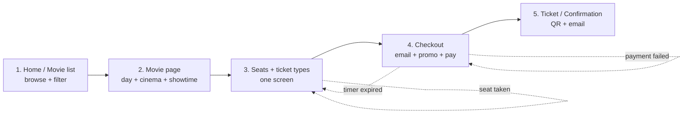

### 11.3 Main User Journey (Customer or Guest)

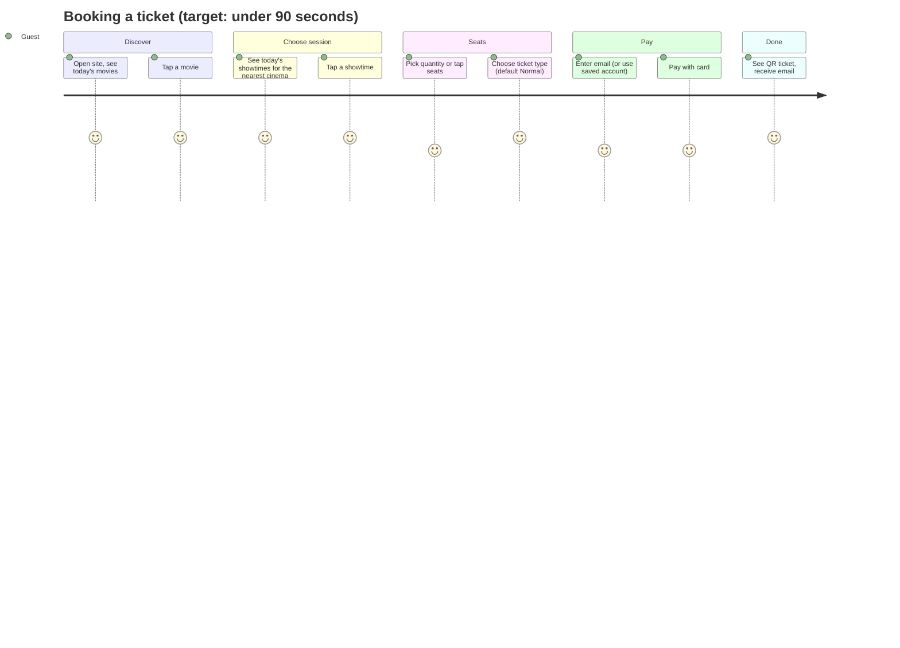

### 11.4 Screen Specifications & Wireframes

> Wireframes are low-fidelity (mobile layout). On desktop, the same components are re-arranged into two columns (see 11.6). Final high-fidelity designs go in Figma (Phase 0).

#### Screen 1 — Home / Movie list `/`

```
┌────────────────────────────────┐
│ ☰  CinePath      🔍   👤       │
├────────────────────────────────┤
│  [ Hero poster + trailer loop ]│
│  Movie title        ⭐ 8.1     │
│  [ 🎟 Book now ]  [ + List ]   │
├────────────────────────────────┤
│ 📍 Casablanca ▾   (nearest)    │
│ (Today) Genre▾ VF/VOSTFR▾ 3D▾  │  ← sticky filter chips
├────────────────────────────────┤
│ Now showing                  > │
│ ┌────┐ ┌────┐ ┌────┐ ┌──      │
│ │    │ │NEW │ │    │ │        │
│ └────┘ └────┘ └────┘ └──      │
│ Title    Title   Title         │
│ Coming soon                  > │
│ ┌────┐ ┌────┐ ┌────┐          │
├────────────────────────────────┤
│ 🎬 Movies  📍Cinemas  🎟 Tickets  👤 │
└────────────────────────────────┘
```

- Loads with **skeleton cards** (no blank screen).
- City/cinema is remembered (cookie/localStorage) and defaults to the nearest.
- Grid/list toggle on `/movies`; the choice is remembered.
- Search opens as a full-width overlay with instant results (title, genre).

#### Screen 2 — Movie page + showtimes `/movies/[slug]`

```
┌────────────────────────────────┐
│ ←                         ⤴ ♡  │
│  [ Backdrop / trailer ▶ ]      │
│  Clayface                      │
│  [12+] 1h49 · Horror · Thriller│
│  ⭐ 8.0   Release: 21 Oct 2026 │
│  Synopsis… (2 lines)  Read more│
├────────────────────────────────┤
│ ‹ Today  Tomorrow  Thu 12  Fri…│  ← scrollable day strip
│ 📍 Cinema: Nearest ▾           │
│ Format: All ▾  Language: All ▾ │
├────────────────────────────────┤
│  Cinema A                      │
│ ┌────────┐ ┌────────┐ ┌──────  │
│ │ 17:30  │ │ 20:00  │ │ 22:30  │
│ │ VOSTFR │ │ VF     │ │ 4DX    │
│ │ from 90│ │ from 90│ │ 130    │
│ │        │ │Few left│ │        │
│ └────────┘ └────────┘ └──────  │
├────────────────────────────────┤
│ Cast & crew · Trailer · Reviews│
└────────────────────────────────┘
```

- Showtimes come **before** cast/reviews — the primary action is on the first screen.
- Each showtime tile shows time, language, format, **starting price**, and an availability badge.
- Past showtimes are greyed out and not tappable. Sold-out showtimes show "Sold out" with a "Notify me" option (future).
- **Tapping a showtime goes directly to the seat screen** (no intermediate sheet).

#### Screen 3 — Seats + ticket types `/booking/[showtimeId]/seats`  ⭐ *key screen*

```
┌────────────────────────────────┐
│ ←  Clayface                    │
│    Tue 10 Nov · 17:30 · VOSTFR │
│    Cinema A · Hall 4 · 101 free│
├────────────────────────────────┤
│  How many seats?  [ − 2 + ]    │
│  [ ✨ Pick best seats for me ]  │
├────────────────────────────────┤
│        ▁▁▁▁▁ SCREEN ▁▁▁▁▁      │
│    ▢▢▢▢  ▢▢▢▢▢▢▢▢  ▢▢▢▢        │
│    ▢▢▢▢  ▢▢▢▢▢▢▢▢  ▢▢▢▢        │
│    ▢▢▢▢  ▢▣▣▢▢▢▢▢  ▢▢▢▢        │
│    ▢▢▢▢  ▢▢▢▢▢▢▢▢  ▢▢▢▢        │
│        [ pinch / +  − ]        │
│  ▢ Free  ▣ Yours  ▨ Taken  ♿ VIP│
├────────────────────────────────┤
│ Your seats                     │
│  C9  [ Normal 90 ▾ ]       ✕   │
│  C10 [ Student 75 ▾ ]      ✕   │
├────────────────────────────────┤
│ Total 165 MAD  [ Continue → ]  │
└────────────────────────────────┘
```

**Behaviour**
- **Two ways to choose:** (a) tap seats on the map, or (b) set a quantity and tap **"Pick best seats for me"** (best available together, centre rows first). The user can then adjust.
- **Ticket type is chosen right here**, per seat, via a small dropdown that defaults to *Normal*. Student/Senior show a short note ("ID required at entrance").
- **Total updates live**; the **Continue** button is disabled with an explanatory label until ≥ 1 seat is chosen ("Select at least 1 seat").
- Seat states are never colour-only: free = outlined, yours = filled + check, taken = crossed, wheelchair = ♿ icon, VIP = badge.
- The map **auto-fits the screen**; pinch/double-tap to zoom; a "+ / −" control is available for users who don't pinch.
- The hint ("Pinch to zoom") shows **once**, then disappears.
- Live updates: seats taken by others turn to *taken* in real time (WebSocket) with a subtle animation.
- **When does the lock start?** Recommended: lock seats when the user taps **Continue** (not on each tap), so users browsing the map don't block others. The 10-minute timer starts at that moment. If any seat was taken in between, show a friendly message and keep the rest of the selection (see 11.7).
- Max 8 seats per booking (configurable) with a clear message when reached.

#### Screen 4 — Checkout `/booking/[bookingId]/checkout`

```
┌────────────────────────────────┐
│ ←  Checkout        ⏱ 09:42     │  ← sticky countdown
├────────────────────────────────┤
│ Clayface · Tue 10 Nov · 17:30  │
│ Cinema A · Hall 4              │
│ Seats C9 (Normal) C10 (Student)│
│ Total                165 MAD   │
├────────────────────────────────┤
│ Email for your e-tickets       │
│ [ you@email.com            ]   │
│ (prefilled if logged in)       │
│ + Have a promo code?           │  ← collapsed link
├────────────────────────────────┤
│ Pay with                       │
│ (•) Card   ( ) Other methods   │
│ [ Card number              ]   │
│ [ MM/YY ] [ CVC ]              │
├────────────────────────────────┤
│ By paying you accept the Terms │
│ of Sale. 🔒 Secure payment     │
│ [      Pay 165.00 MAD      ]   │
└────────────────────────────────┘
```

- **Single page** for summary + email + payment. Payment form is **embedded** (e.g., Stripe Payment Element) — no redirect to an unbranded page.
- Logged-in users: email prefilled, no extra step. Guests: only an email is needed.
- **One** consent line next to the Pay button (use a checkbox only if the law in your market requires explicit opt-in).
- The Pay button shows the exact amount and a loading state ("Processing…") that prevents double clicks.
- Promo code is collapsed by default; success shows the discount line in the summary.
- Edit links ("Change seats") return to Screen 3 **without losing the lock** while the timer is still valid.

#### Screen 5 — Confirmation / Ticket `/tickets/[bookingId]`

```
┌────────────────────────────────┐
│          ✔  You're all set!    │
│  Sent to you@email.com         │
├────────────────────────────────┤
│  ┌──────────────┐              │
│  │   [ QR ]     │              │
│  └──────────────┘              │
│  Clayface · Tue 10 Nov · 17:30 │
│  Cinema A · Hall 4 · C9, C10   │
│  Booking #CP-48213             │
├────────────────────────────────┤
│ [ ⬇ Download PDF ] [ 📅 Add to │
│   calendar ] [ 📍 Directions ] │
│ [ Create an account to keep    │
│   all your tickets ]  (guests) │
└────────────────────────────────┘
```

- QR is shown **immediately** (no waiting for the email) and works offline once opened (cached page).
- Brightness-boost on the QR view for easy scanning at the entrance.
- Guests get an optional **"Create account"** prompt *after* purchase (one tap, email already known) — never before.
- "Cancel booking" is available from `/tickets` according to the cancellation rule (see 11.7).

#### Supporting screens

| Screen | Route | Key UX points |
|---|---|---|
| My tickets | `/tickets` | Tabs **Upcoming / Past**; upcoming tickets show the QR in one tap; countdown "Today 17:30". |
| Cinemas | `/cinemas` | List with distance, address, map; tap → that cinema's showtimes. |
| Login / Register | `/login`, modal | Email + password **or** Google; "Continue as guest" is always visible during checkout; magic-link option. |
| Account | `/account` | Profile, language, saved preferences, data export/delete (GDPR). |
| Admin | `/admin/*` | Separate layout; dense tables + charts; hall grid editor (see 11.8). |

### 11.5 Route Map (Next.js App Router)

```
/                                   Home
/movies                             Movie list (filters, grid/list)
/movies/[slug]                      Movie page + showtimes
/cinemas                            Cinemas list
/cinemas/[slug]                     Cinema page + today's showtimes
/booking/[showtimeId]/seats         Seat + ticket-type selection
/booking/[bookingId]/checkout       Checkout + payment
/tickets                            My tickets
/tickets/[bookingId]                Ticket / confirmation (QR)
/login  /register  /account         Auth & profile
/admin/...                          Back-office
/staff/validate                     QR scanner page
```

> The booking URLs are shareable/bookmarkable and reload-safe: state lives in the URL + server (lock token), not only in memory.

### 11.6 Responsive Behaviour

| Breakpoint | Layout |
|---|---|
| **Mobile** (< 768 px) | Single column; bottom primary action bar; bottom navigation (Movies · Cinemas · Tickets · Account). |
| **Tablet** (768–1023 px) | Seat map larger; summary as a bottom sheet. |
| **Desktop** (≥ 1024 px) | Top navbar; **two columns** on booking screens: seat map (left, ~65 %) + sticky order summary with timer & Continue button (right, ~35 %). Checkout: form left, summary right. |

### 11.7 Edge Cases & Error States (UX Copy)

| Situation | What the user sees | What happens |
|---|---|---|
| Seat taken by someone else before **Continue** | Toast: *"Seat C9 was just taken. We kept your other seats — pick another or tap **Suggest a seat**."* | Map refreshes; the rest of the selection is preserved. |
| Timer reaches 02:00 | Soft banner: *"2 minutes left to complete your payment."* | Timer turns amber. |
| Timer expires | Modal: *"Your seats were released. Pick them again?"* with **Same showtime** button | Returns to Screen 3 with the same showtime; no data lost. |
| Payment declined | Inline error under the card form: *"Your card was declined. Try another card."* | Lock stays valid while timer runs; user can retry. |
| Payment succeeded **after** the lock expired (late webhook) | Page: *"Payment received but the seats are no longer available. You'll be refunded automatically in X days."* | Backend auto-refund (see §7.3); email confirmation of the refund. |
| Connection lost during seat selection | Banner: *"You're offline — reconnecting…"*; Continue is disabled | WebSocket auto-reconnect, map re-synced. |
| Showtime sold out | Disabled tile "Sold out" | Optional waitlist (future work). |
| Cancellation | Confirm dialog showing refund amount and deadline | Seats released and re-sellable (see §8.2). |
| Empty states | "No showtimes today — try tomorrow" with the next available day shown as a button | Never a dead-end. |

### 11.8 Admin Back-Office UX (Short)

- **Dashboard first**: today's sales, occupancy %, top movies, upcoming sessions.
- **Hall grid editor:** click/drag to paint cells as *seat / aisle / VIP / wheelchair / broken*; live preview of the customer-facing seat map.
- **Showtime scheduler:** weekly calendar view (hall × time), drag to create, automatic conflict detection (overlap, cleaning buffer).
- **Staff validation page:** full-screen camera scanner; result in 1 second as a large **green ✔ VALID / red ✖ INVALID / orange ⚠ ALREADY USED** with movie, hall and seat details.

### 11.9 Visual Design System

| Aspect | Recommendation |
|---|---|
| **Theme** | Dark theme by default (cinema feel; posters pop), with a light theme option. |
| **Brand colour** | Choose **your own** accent colour (avoid the reference app's yellow/black pairing to keep your identity distinct). |
| **Semantic colours** | Success green, warning amber, error red, info blue — always paired with an icon/label. |
| **Typography** | One sans-serif family (e.g., Inter / Poppins; add an Arabic-capable family such as Cairo or Noto Sans Arabic). Scale: 12 / 14 / 16 / 20 / 28 / 36. |
| **Spacing & radius** | 4-px grid; radius 12 px for cards, 999 px for chips. |
| **Core components** (shadcn/ui) | `Button`, `Badge`, `Card`, `Tabs`, `Sheet` (bottom sheet), `Dialog`, `Toast`, `Skeleton`, `Select`, `Calendar`, `Form`. |
| **Custom components** | `MoviePoster`, `ShowtimeTile`, `DateStrip`, `SeatMap`, `Seat`, `SeatLegend`, `TicketTypeSelect`, `OrderSummary`, `CountdownTimer`, `QRTicket`. |
| **Motion** | Subtle (150–250 ms); respects `prefers-reduced-motion`. |
| **Images** | Next.js `<Image>` with blur placeholders, responsive posters, fixed aspect ratio (2:3) to avoid layout shift. |

### 11.10 Accessibility, Language & Localisation

- **WCAG 2.1 AA**: contrast ≥ 4.5:1, visible focus rings, semantic HTML, `aria-live` for toasts and timer warnings.
- **Seat map accessibility:** every seat is a focusable button with a label such as *"Row C, seat 9, free, Normal 90 MAD"*; arrow keys move between seats, Space/Enter toggles; screen-reader announcement "2 seats selected, total 165 MAD".
- **Touch targets** ≥ 44 × 44 px (seats auto-scale; if too small at default zoom, use zoom-to-area).
- **Languages:** start with **French + English**, designed so **Arabic (RTL)** can be added without redesign: use logical CSS properties (`margin-inline-start`), `dir="rtl"`, and externalised strings (`next-intl`).
- **Currency & dates:** MAD with the format `90.00 MAD` (or `90,00 DH`), local date/time formats, 24-h time.
- **Forms:** inline validation (Zod), correct `inputmode`/`autocomplete` attributes (email, card), no long forms.

### 11.11 UX Success Metrics

| Metric | Target |
|---|---|
| Time from movie page to ticket | **< 90 s** (median) |
| Booking completion rate (seat screen → ticket) | **> 60 %** |
| Seat-conflict errors per 100 bookings | **< 3** |
| Timer-expiry rate | **< 8 %** |
| Payment success rate | **> 92 %** |
| Mobile LCP | **< 2.5 s** |
| Usability test | 5 users complete a booking **unaided**, with an average SUS score ≥ 80 |

Measure with funnel analytics per step (Home → Movie → Seats → Checkout → Ticket) and review drop-off after launch.

### 11.12 Impact on the Rest of the Plan

The UX decisions above require small additions elsewhere:

| Area | Change |
|---|---|
| **DB** | Add `ticket_types` (id, name, price or modifier, `requires_proof`) and store `ticket_type_id` on each booked seat; price = `base_price + seat modifier` then ticket-type rule. |
| **DB** | Make `bookings.user_id` nullable and add `guest_email` (guest checkout); add a signed **access token / magic link** to view a guest's ticket. |
| **API** | `GET /showtimes/:id/availability` (counts for badges), `POST /showtimes/:id/suggest-seats` (best available), `GET /showtimes?movie=&date=&cinema=` returning `fromPrice` and `availabilityLevel`. |
| **Frontend** | Persist booking progress (URL + lock token); WebSocket reconnect logic; countdown driven by server `expiresAt` (not client clock). |
| **Requirements** | New FRs: *FR-15 Guest checkout*, *FR-16 Best-seat suggestion*, *FR-17 Visible hold timer*, *FR-18 Ticket types per seat*. |

---

## 12. Project Structure

```
cinepath/
├── apps/
│   ├── web/                    # Next.js frontend
│   │   ├── app/                # routes (App Router)
│   │   ├── components/
│   │   ├── features/           # movies, booking, auth, admin
│   │   ├── lib/                # api client, utils
│   │   └── tests/
│   └── api/                    # Node.js backend
│       ├── src/
│       │   ├── modules/        # auth, users, movies, showtimes, bookings, payments
│       │   ├── common/         # guards, filters, interceptors, redis-lua
│       │   ├── config/
│       │   └── main.ts
│       ├── prisma/
│       │   ├── schema.prisma
│       │   └── migrations/
│       └── test/
├── packages/
│   └── shared/                 # shared types & validation schemas
├── docs/                       # diagrams, ADRs, API docs
├── docker-compose.yml
├── .github/workflows/          # CI/CD
├── .env.example
└── README.md
```

---

## 13. Development Phases (Roadmap)

> Estimated for a solo developer working part-time. Adjust to your pace.

### 🟦 Phase 0 — Conception & Setup (1 week)
- [ ] Finalize requirements & scope (this document)
- [ ] UML, ERD, wireframes (Figma)
- [ ] UX: clickable Figma prototype of the 5-screen booking flow (§11); test it with 3–5 people before coding
- [ ] Create GitHub repo, branching strategy, issue board
- [ ] Setup monorepo, ESLint, Prettier, Husky, TypeScript
- [ ] Docker Compose (PostgreSQL + Redis)

**Deliverable:** repo skeleton + design docs

### 🟩 Phase 1 — Foundation & Auth (1–2 weeks)
- [ ] Database schema + Prisma migrations + partial unique indexes + seed data
- [ ] User registration/login, JWT + refresh, email verification
- [ ] RBAC middleware
- [ ] Base UI layout, design system (tokens, dark theme, shadcn components), responsive navbar + mobile bottom nav
- [ ] i18n setup (FR/EN, RTL-ready) and skeleton-loading pattern

**Deliverable:** working authentication

### 🟨 Phase 2 — Catalog (2 weeks)
- [ ] Movies, genres, cinemas, halls CRUD with grid layout editor (admin)
- [ ] Public movie list (search, filters, pagination)
- [ ] Movie details page (trailer, cast, rating)
- [ ] Showtimes management & listing (audio, subtitles, projection format)
- [ ] SEO: metadata, sitemap, Open Graph
- [ ] UX: sticky filter chips, date strip, showtime tiles with price + availability badge

**Deliverable:** browsable cinema catalog

### 🟧 Phase 3 — Booking Engine (2–3 weeks) ⭐ *core*
- [ ] Interactive grid seat picker (supporting aisles, VIP surcharges, wheelchair spots)
- [ ] Atomic Redis Lua multi-seat locking with 10m UI / 12m backend TTL
- [ ] Real-time seat updates (WebSocket)
- [ ] Booking creation + deterministic price calculation (`base_price + price_modifier`)
- [ ] Concurrency tests (parallel multi-seat booking simulations)
- [ ] UX: combined seat + ticket-type screen, best-seat quick pick, accessible seat map (keyboard + ARIA), countdown timer, seat-taken recovery

**Deliverable:** reliable seat reservation

### 🟥 Phase 4 — Payments & Tickets (2 weeks)
- [ ] Stripe integration (test mode) + webhooks + late-webhook auto-refund handler
- [ ] HMAC-signed QR-code ticket generation, PDF export
- [ ] Confirmation & refund emails
- [ ] Booking history, cancellation & seat release flow
- [ ] Promo codes with atomic usage increment
- [ ] UX: single-page embedded checkout, guest checkout + post-purchase account prompt, QR ticket page (offline-capable)

**Deliverable:** end-to-end purchase flow

### 🟪 Phase 5 — Admin Dashboard & Staff Tools (2 weeks)
- [ ] Dashboard: sales, occupancy, top movies (charts)
- [ ] Manage users, bookings, promo codes
- [ ] Staff QR validation page (HMAC verification + status update)
- [ ] Audit log

**Deliverable:** full back-office

### ⬛ Phase 6 — Quality, Security & Performance (1–2 weeks)
- [ ] Unit, integration, and E2E tests (Playwright)
- [ ] Security review against OWASP Top 10
- [ ] Rate limiting, caching, image optimization
- [ ] Accessibility audit, Lighthouse > 90
- [ ] Usability testing (5 users, unaided booking) + funnel analytics review (§11.11)
- [ ] Load testing (k6)

**Deliverable:** production-ready build

### ⬜ Phase 7 — Deployment & Launch (1 week)
- [ ] CI/CD pipeline (GitHub Actions)
- [ ] Production environment, domain, SSL
- [ ] Monitoring (Sentry), backups, uptime checks
- [ ] Legal pages: Privacy Policy, Terms, Cookies
- [ ] Beta launch & feedback

**Deliverable:** live v1.0 🚀

### 📱 Phase 8 — Mobile (Future)
- [ ] Convert to PWA (manifest, service worker, push)
- [ ] Wrap with Capacitor / TWA → Google Play (AAB)
- [ ] Optional: React Native app using the same API

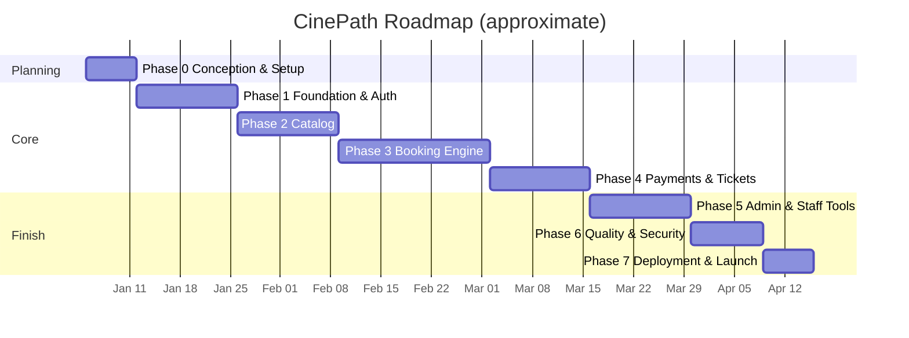

---

## 14. Testing Strategy

| Level | Tools | Focus |
|---|---|---|
| Unit | Jest | Services, price calculation, HMAC QR signer, validators |
| Integration | Supertest + test DB | API endpoints, partial unique indexes, webhook fallbacks |
| Concurrency | Custom scripts / k6 | Parallel booking of overlapping seat selections |
| E2E | Playwright | Full booking, cancellation, and re-booking journey |
| Usability | Moderated test (5 users), SUS survey | Can a new user book unaided in < 90 s? |
| Accessibility | axe, keyboard-only run, screen reader | Seat map & checkout usable without a mouse |
| Security | OWASP ZAP, `npm audit` | Vulnerability scanning |
| Performance | Lighthouse, k6 | Web vitals, load |

**Target:** ≥ 80% coverage on business-critical modules (booking, payment, locking).

---

## 15. DevOps & Deployment

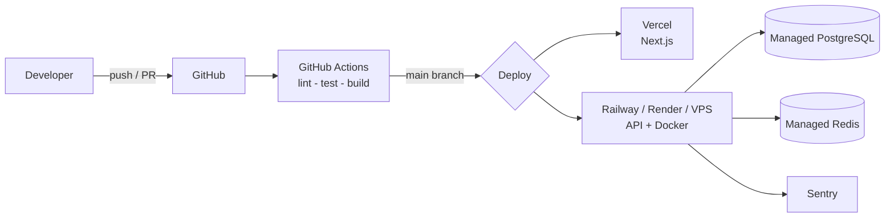

- **Environments:** `development` → `staging` → `production`
- **Branching:** `main` (stable), `develop`, `feature/*`; Conventional Commits
- **Config:** `.env.example` documented; secrets stored in platform vaults
- **Migrations:** `prisma migrate deploy` on release

---

## 16. Risks & Mitigation

| Risk | Impact | Mitigation |
|---|---|---|
| Double-booking of seats | High | Atomic Redis Lua locks + DB partial unique index + transactions |
| Late payment after lock expiry | High | 2-min Redis grace buffer + automatic Stripe refund on DB constraint conflict |
| Cancelled seats permanently blocked | High | Partial unique index `WHERE status IN ('ACTIVE', 'USED')` |
| Payment/webhook failures | High | Idempotent webhooks, retries, reconciliation job |
| Traffic spikes (new blockbuster) | Medium | Caching, CDN, horizontal scaling, queue |
| Scope creep | Medium | Strict phases, MVP first |
| Security breach / forged QR | High | Security plan, HMAC-signed QR payloads, least privilege |
| Legal/trademark issues | Medium | Original branding, privacy & terms pages |

---

## 17. Future Work

- 📱 PWA + Google Play app (Capacitor/TWA) and iOS
- 🔔 Push notifications for new releases and reminders
- 🍿 Snacks & beverages pre-order
- 🎁 Loyalty points, gift cards, subscriptions
- 🌍 Multi-language & multi-currency (Arabic / French / English, RTL)
- 🤖 Movie recommendations
- 📊 Advanced analytics & dynamic pricing

---

## 18. Contributing & License

Contributions are welcome! Please open an issue first to discuss major changes.

```bash
# Quick start (once implemented)
git clone https://github.com/<your-username>/cinepath.git
cd cinepath
cp .env.example .env
docker compose up -d      # PostgreSQL + Redis
npm install
npm run db:migrate
npm run dev
```

**License:** MIT (or your preferred license)

---

<p align="center">Built with ❤️ using Next.js, Node.js & PostgreSQL</p>